<picture>
  <source media="(prefers-color-scheme: dark)" srcset="./assets/github-header-dark.svg"/>
  <source media="(prefers-color-scheme: light)" srcset="./assets/github-header-light.svg"/>
  
</picture>

 

&nbsp;

&nbsp;

---

## Selected Projects

<table>
<tr>
<td width="50%" valign="top">

<h3>⌘ KodiTrack</h3>

**Property management, connected.**

A rental management platform bringing property operations, tenants, leases, payments and maintenance into one application.

  

</td>
<td width="50%" valign="top">

<h3>▤ GwenBooks</h3>

**Discover. Explore. Read.**

A digital book discovery and reading platform built around a modern web application architecture.

  

</td>
</tr>
<tr>
<td width="50%" valign="top">

<h3>⌘ Echo Chatroom</h3>

**Real-time communication, powered by Java.**

A browser-based chat application exploring WebSocket communication, backend services and live application deployment.

  

</td>
<td width="50%" valign="top">

<h3>◈ PesaChain</h3>

**Microfinance with verifiable records.**

Exploring the integration of blockchain smart contracts with conventional backend systems for transparent loan management.

  

</td>
</tr>
</table>

---

## Engineering Stack

**BACKEND & LANGUAGES**

<picture>
  <source media="(prefers-color-scheme: dark)" srcset="https://skillicons.dev/icons?i=java,spring,js,ts,python,c&theme=dark"/>
  
</picture>

  

**FRONTEND**

<picture>
  <source media="(prefers-color-scheme: dark)" srcset="https://skillicons.dev/icons?i=react,nextjs,vite,tailwind&theme=dark"/>
  
</picture>

  

**DATA & INFRASTRUCTURE**

<picture>
  <source media="(prefers-color-scheme: dark)" srcset="https://skillicons.dev/icons?i=postgres,mysql,docker,linux,git,github&theme=dark"/>
  
</picture>

<b>Additional technologies & tools</b>

 

`Spring Security` · `Spring Data JPA` · `Hibernate` · `Maven` · `JUnit` · `REST APIs` · `WebSocket` · `JWT` · `Bash` · `Solidity` · `Hardhat` · `Ganache` · `MetaMask` · `Cloudflare Workers` · `Drizzle ORM` · `Postman`

---

## Beyond the Featured Projects

<b>Other engineering work</b>

 

**AfyaFlow** — Hospital queue and appointment management.

`Spring Boot` `Spring Security` `MySQL` `React` `Docker`

**AttendEase** — Attendance management with rule-based attendance cutoffs.

`React` `Vite` `Tailwind CSS`

---

## Current Engineering Focus

`System Design` · `Distributed Systems` · `Linux` · `Docker` · `Cloud Infrastructure` · `CI/CD` · `Platform Engineering`

---

### Have an interesting problem to solve?

  

<a href="https://www.linkedin.com/in/jamesbrian254">LinkedIn</a>
&nbsp; · &nbsp;
<a href="mailto:jamesbriandungu@gmail.com">Email</a>
&nbsp; · &nbsp;
<a href="https://github.com/James-oss796">GitHub</a>

  

JAMES BRIAN NDUNG'U · BACKEND SOFTWARE ENGINEER

