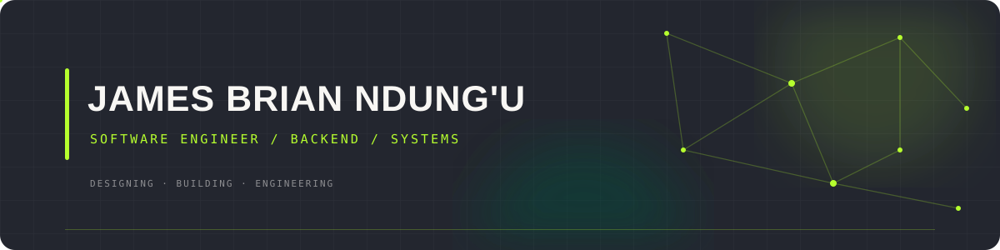

 

**SOFTWARE ENGINEER · BACKEND · SYSTEMS**

Building software that solves real problems, with an interest in the systems behind it.

 

&nbsp;

&nbsp;

---

## Selected Work

<table>
<tr>
<td width="50%" valign="top">

### 01 / KodiTrack

**Rental property management, rethought.**

A property management platform designed to bring landlords, tenants, properties and rental operations into one system.

`React` `TypeScript` `Hono` `Cloudflare D1`

</td>
<td width="50%" valign="top">

### 02 / GwenBooks

**A better way to discover and read books.**

A digital book discovery and reading platform combining modern web technologies with persistent data and application services.

`Next.js` `TypeScript` `PostgreSQL` `Drizzle`

</td>
</tr>
<tr>
<td width="50%" valign="top">

### 03 / Echo Chatroom

**Real-time communication on the web.**

A Java-based chat application exploring WebSocket communication and the integration of frontend clients with backend services.

`Java` `Spring Boot` `WebSocket` `JavaScript`

</td>
<td width="50%" valign="top">

### 04 / PesaChain

**Blockchain meets microfinance.**

Exploring how smart contracts and conventional backend architecture can work together to support transparent loan management.

`Spring Boot` `PostgreSQL` `Solidity` `Ethereum`

</td>
</tr>
</table>

---

## Technology

**BACKEND & LANGUAGES**

  

**FRONTEND**

  

**DATABASES & INFRASTRUCTURE**

  

**ALSO WORKING WITH**

`Spring Security` · `Hibernate` · `REST APIs` · `WebSocket` · `Solidity` · `Hardhat` · `Cloudflare Workers` · `Bash`

---

## Currently Exploring

`System Design` · `Docker` · `Linux` · `Cloud Infrastructure` · `DevOps` · `Distributed Systems`

---

**Have an interesting engineering problem or opportunity?**

  

JAMES BRIAN NDUNG'U · SOFTWARE ENGINEER

